<p align="center">
  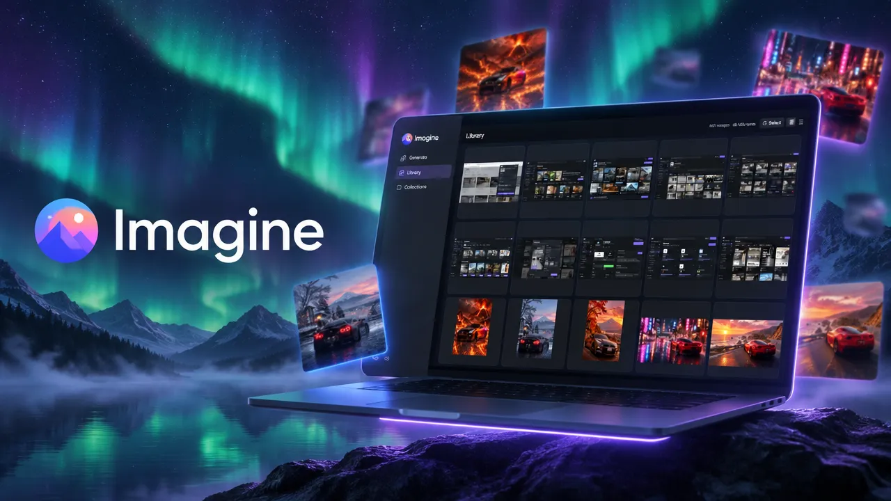
</p>

# Imagine

A local AI image studio. Generate images with OpenAI's `gpt-image-2.5-sunburst` model, keep every one of them in a browsable library on your own machine, and see exactly what each one cost.

**No subscription, no account, no server.** You bring an OpenAI API key and pay per image, at a fraction of a cent.

## Screenshots

<p align="center">
  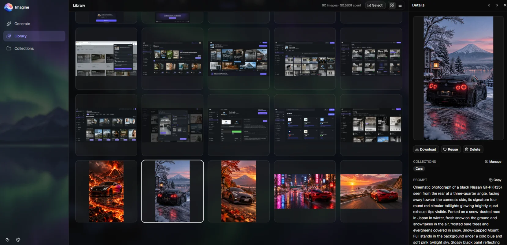
  <br>
  <em>The library, with the details panel open on an image</em>
</p>

<table>
  <tr>
    <td width="50%">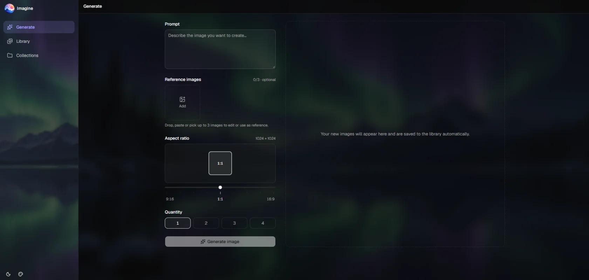</td>
    <td width="50%">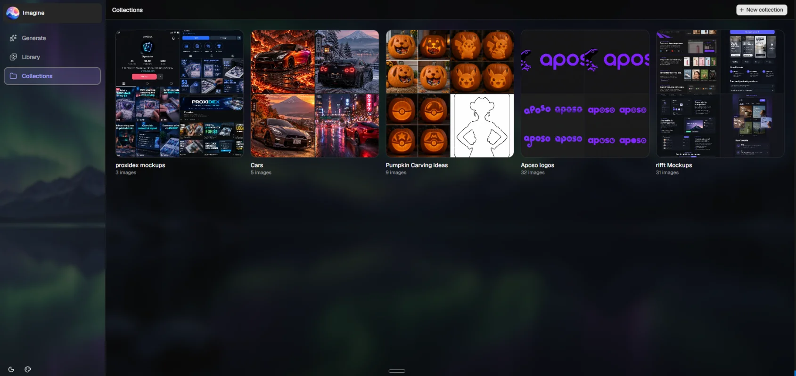</td>
  </tr>
  <tr>
    <td align="center"><em>Generate: prompt, up to 3 reference images, aspect ratio, quantity</em></td>
    <td align="center"><em>Collections, with cover mosaics</em></td>
  </tr>
</table>

## What it costs

| Request | Typical cost per image | Images per $1 |
| --- | --- | --- |
| Text prompt only | ~$0.003 - $0.005 | ~200 - 330 |
| Prompt + 1 reference image | ~$0.0097 | ~100 |

These are figures from real use: one image at roughly 1 megapixel on the `low` quality setting. Your numbers will vary a little with prompt length and aspect ratio, and OpenAI can change its rates, so check [their pricing page](https://openai.com/api/pricing/) against the rates in [lib/image-config.ts](lib/image-config.ts).

Compare that with a monthly AI subscription: a hundred images here costs about a dollar, and a month you don't use it costs nothing.

Every image records its own token usage, cost and settings, so you can see where the money went:

<table>
  <tr>
    <td width="50%">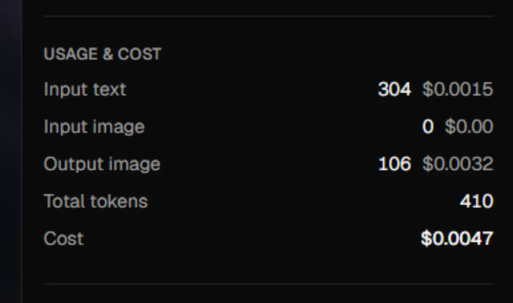</td>
    <td width="50%">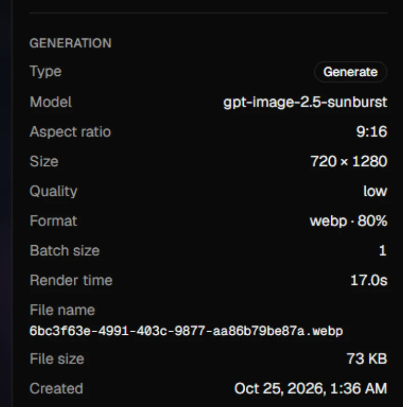</td>
  </tr>
  <tr>
    <td align="center"><em>Token usage and cost, per image</em></td>
    <td align="center"><em>The settings it was made with</em></td>
  </tr>
</table>

## Why I built it

Image generation through a chat app or a subscription site has a few annoyances that add up. Imagine is built around fixing them:

- **Paying for things you don't need.** The API bills reference images by pixel count, so a 12 MP phone photo costs far more than it should, with no benefit to the result. Imagine automatically shrinks the copy it sends (to ~0.2 MP by default, applying EXIF rotation, never upscaling) and keeps your original untouched in the library. This is where most of the saving on reference-image edits comes from, and it's adjustable if you ever want more detail. See [Reference image cost](#reference-image-cost).
- **Losing your images.** The API hands an image back once and doesn't keep a library for you. Imagine saves every image to disk and every prompt, setting and cost to a local SQLite database, so you can always find it again and reuse its settings.
- **No idea what you're spending.** Cost is calculated from the token usage OpenAI returns for each request. Every image shows its cost and token breakdown, and the library shows your running total.
- **A pile of images with no structure.** Collections let you group images for a project or a client, and select mode lets you add, remove or delete dozens at once.
- **Subscriptions and lock-in.** It's a local app: your images and prompts stay on your machine (apart from the API call itself), and you can stop using it whenever you like without losing anything.

## Features

**Generate**
- Prompt plus up to 3 optional reference images, 9 aspect ratios from 9:16 to 16:9, and 1-4 images per request
- Text-only requests use `/v1/images/generations`; requests with reference images use `/v1/images/edits`
- Output is fixed to `low` quality, `webp`, compression 80, which keeps renders cheap and files small
- Several generations can run at once, with pending ones shown while you keep working

**Library**
- Card and list views with infinite scroll, a details panel (prompt, settings, token usage, cost) and a zoomable full-screen viewer
- "Reuse" any image's prompt and aspect ratio in one click
- Running totals for images made and money spent

**Collections**
- A collections page with cover mosaics, and a page per collection
- Add an image to as many collections as you like, from its details panel
- **Select mode** for bulk work: tick images (shift-click for ranges, one checkbox for select all), then add them to collections, remove them from one, or delete them, with confirmations and toasts so you always see what happened

**Make it yours**
- Set a background image for the sidebar, the main area, or both: upload your own or pick one of five bundled presets (generated with the same model the app uses). Blur and overlay opacity are adjustable, and the overlay follows the light or dark theme, so text stays readable. Settings are stored with your library, so every device sees the same look.
- Icon-only light/dark theme toggle.

<table>
  <tr>
    <td width="50%">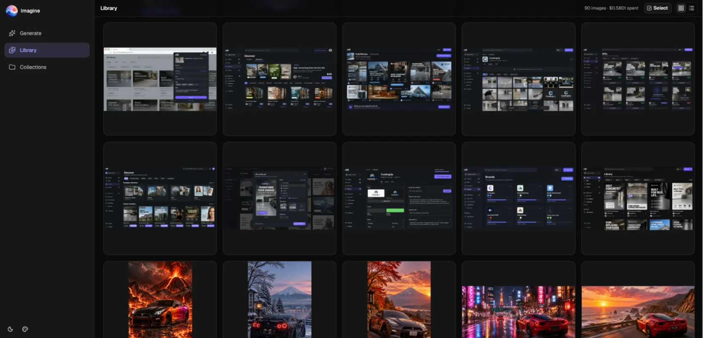</td>
    <td width="50%">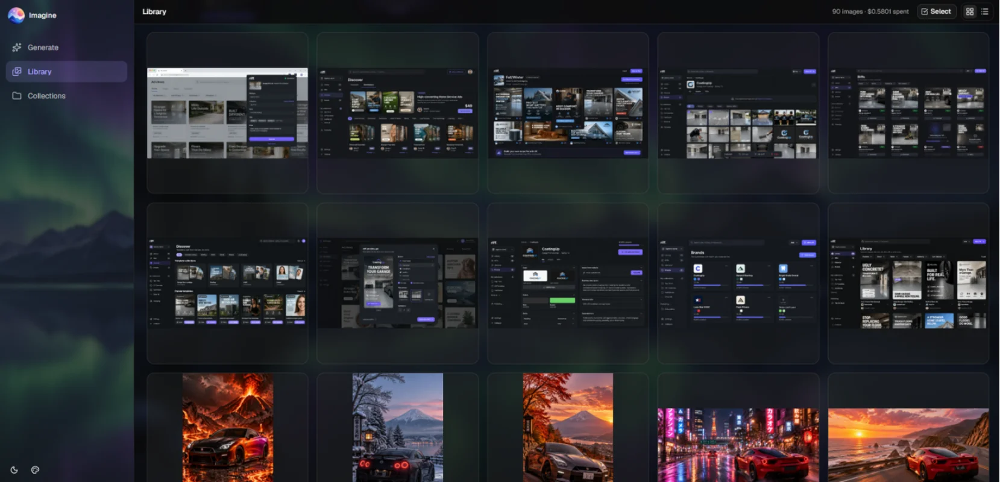</td>
  </tr>
  <tr>
    <td align="center"><em>Before</em></td>
    <td align="center"><em>After: a preset background on the sidebar and main area</em></td>
  </tr>
  <tr>
    <td>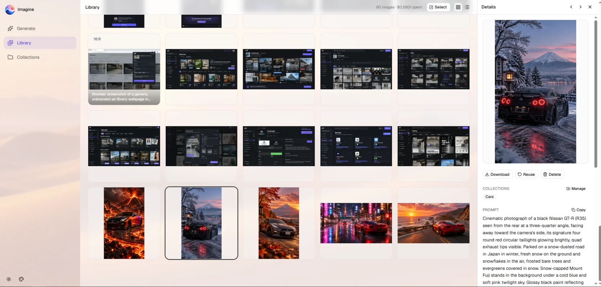</td>
    <td>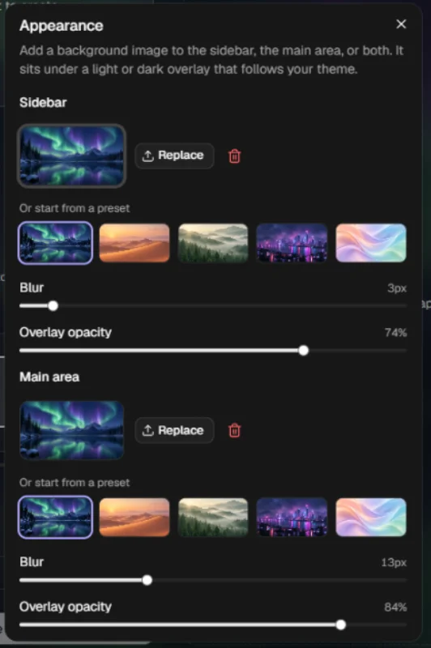</td>
  </tr>
  <tr>
    <td align="center"><em>The overlay follows the theme, so light mode stays light</em></td>
    <td align="center"><em>Blur and overlay opacity, per region</em></td>
  </tr>
</table>

**On your phone**
- A mobile layout with a thumb-reach tab bar (Library, Generate, Collections). See [Using it from your phone](#using-it-from-your-phone).

<p align="center">
  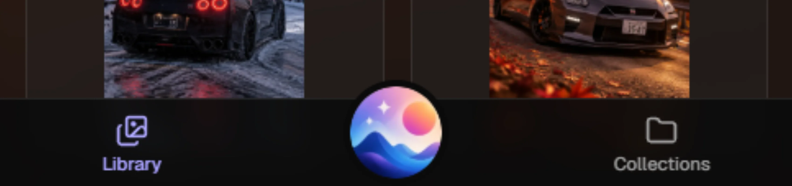
</p>

**From Claude Desktop**
- A small MCP server lets Claude generate and show images in chat. See [Use it from Claude Desktop](#use-it-from-claude-desktop-mcp).

<p align="center">
  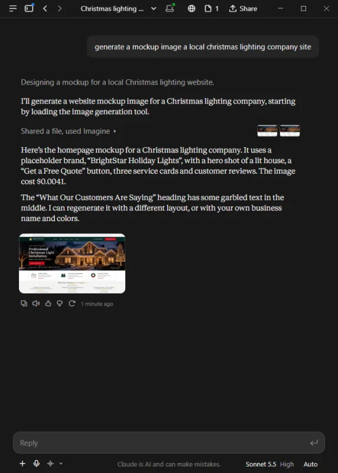
</p>

## Tech

Next.js 16 (App Router and route handlers), React 19, TypeScript, Tailwind CSS 4, shadcn/ui (Radix), Motion, Sonner, SQLite via Node's built-in `node:sqlite`, `sharp` for image processing, Zod for validation, and the Model Context Protocol SDK. No external database or hosted services.

## Setup

Needs Node 22.13+ and an OpenAI API key.

```bash
pnpm install
cp .env.local.example .env.local   # then set OPENAI_API_KEY
pnpm dev   # serves on http://localhost:4000
```

For everyday use, `pnpm build && pnpm start` runs the faster production server on the same port.

## Where data lives

Created on first use, in the project root by default (git-ignored). Set `LIBRARY_DIR` in `.env.local` to keep them somewhere else, e.g. `LIBRARY_DIR=C:\Users\you\Pictures\imagine`, then restart the server.

- `<LIBRARY_DIR>/images/out/` generated images, `images/inputs/` attached reference images
- `<LIBRARY_DIR>/data/library.db` SQLite database (prompts, settings, token usage, cost, collections)

Changing the location doesn't migrate an existing library: move both folders yourself.

Cost is computed from the token usage OpenAI returns, using these rates (USD per million tokens) from [lib/image-config.ts](lib/image-config.ts): $5 text input, $8 image input, $30 image output.

## Reference image cost

OpenAI bills input images by pixel count, so reference images are downscaled (longest edge 512px by default, WebP, EXIF rotation applied, never upscaled) before being sent. Your original upload is saved untouched in the library. Set `IMAGE_INPUT_MAX_EDGE` in `.env.local` to change the size, or `0` to send originals. Raise it if edits to detailed images come out soft. See [lib/image-prep.ts](lib/image-prep.ts).

## Using it from your phone

Run the app on your computer and open it from your phone's browser at your computer's address (for example `http://192.168.1.20:4000`). It works on the same Wi-Fi, or from anywhere over a private network like Tailscale.

In dev mode Next.js only trusts `localhost` by default, so [next.config.ts](next.config.ts) allows `192.168.*.*`, Tailscale's `100.*.*.*` and `*.ts.net`. Add your own host to `allowedDevOrigins` if you use something else. The production server (`pnpm start`) has no such restriction.

## Use it from Claude Desktop (MCP)

[mcp/server.ts](mcp/server.ts) is a local MCP server that lets Claude generate images in chat. It calls this app's API, so the app must be running (`pnpm dev`). It provides `generate_image` (with optional local reference-image paths), `list_recent_images` and `view_image`, and Claude shows the results inline.

Add it to Claude Desktop's config (Settings → Developer → Edit Config opens the right file: `claude_desktop_config.json`, not `config.json`; for the Microsoft Store install it lives under `%LOCALAPPDATA%\Packages\Claude_*\LocalCache\Roaming\Claude\`). Add `mcpServers` at the top level of that file, then restart Claude Desktop:

```json
{
  "mcpServers": {
    "imagine": {
      "command": "node",
      "args": ["C:/path/to/image-gen/mcp/server.ts"],
      "env": { "IMAGINE_APP_URL": "http://localhost:4000" }
    }
  }
}
```

Needs Node 22.18+ (it runs the TypeScript file directly). Set `IMAGINE_APP_URL` to wherever the app is listening.
